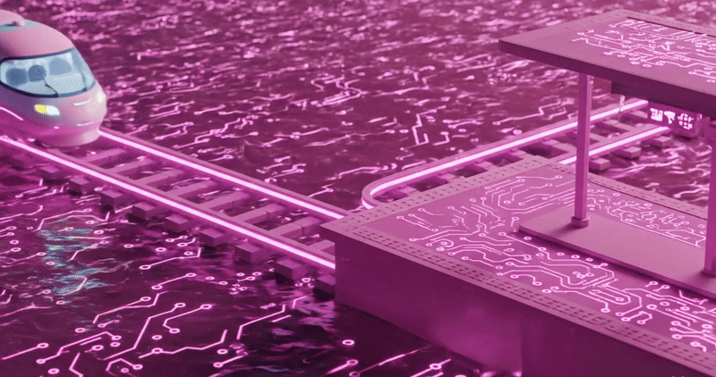
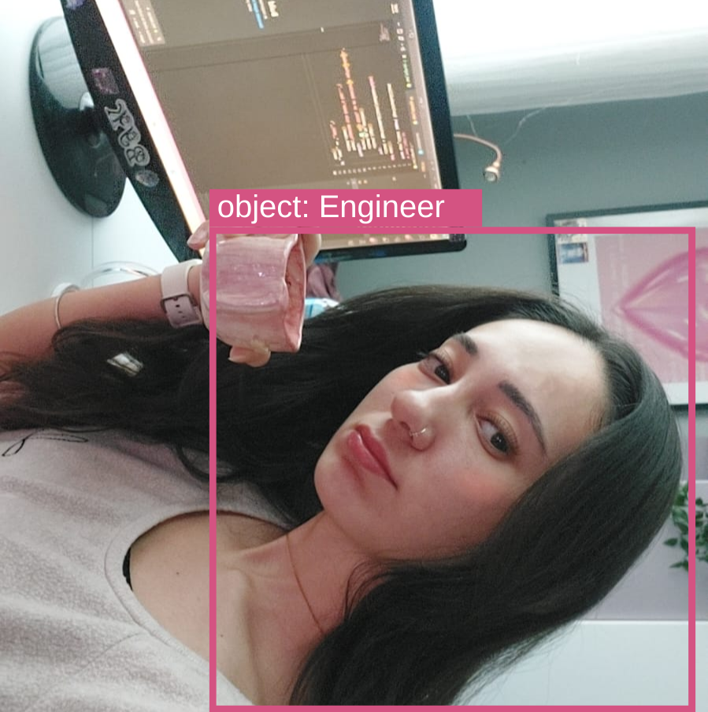
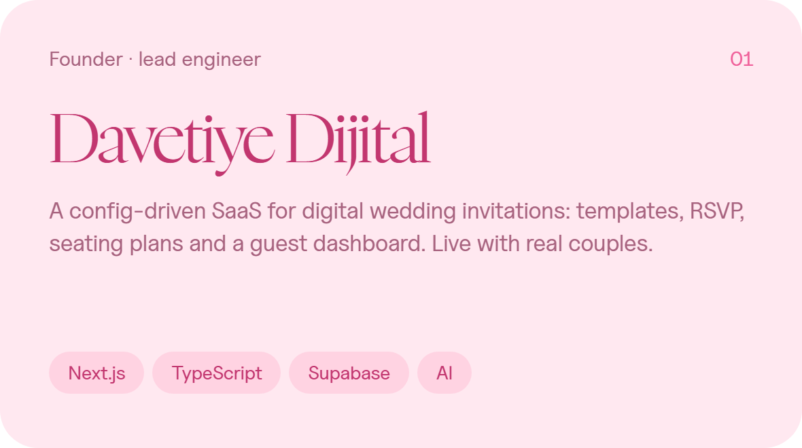
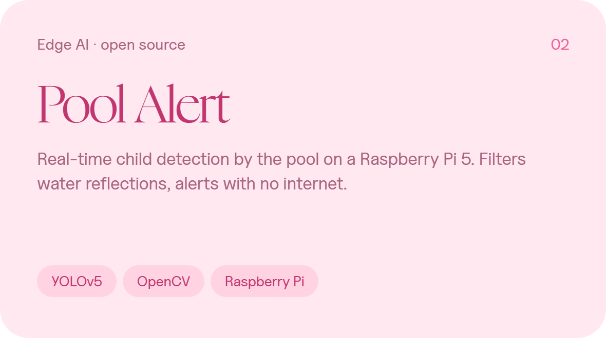
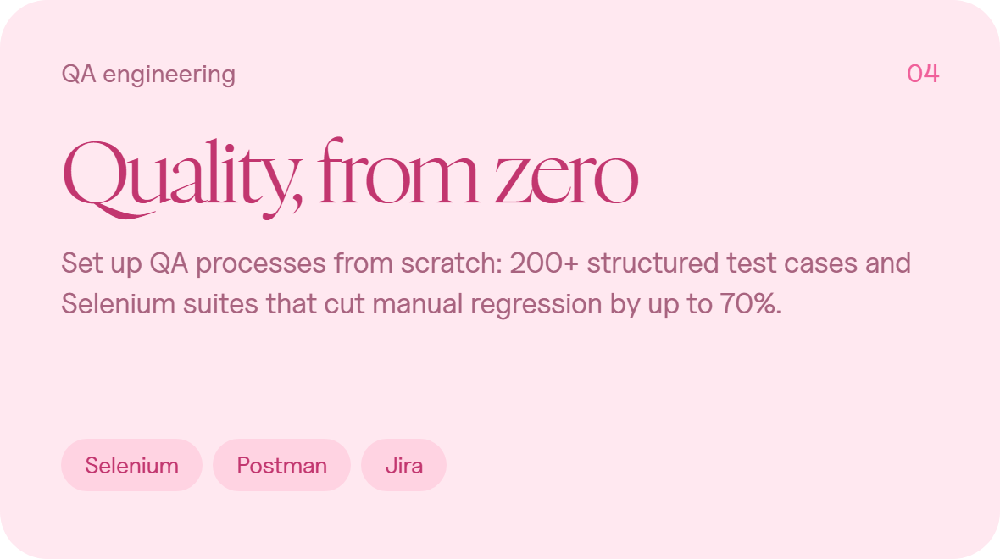
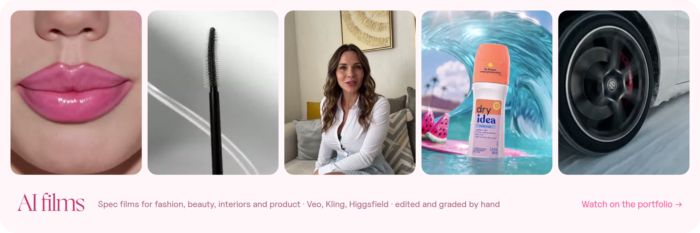

  

<h1 align="center">Zeynep Şevval Düzel</h1>
<h3 align="center">
  Software &amp; QA Engineer &nbsp;·&nbsp; AI Automation Engineer &nbsp;·&nbsp; Computer Engineer
  &nbsp;
</h3>

---

### 🎀 About Me

<table>
  <tr>
    <td>
      I'm a <b>Computer Engineer</b> working across <b>software engineering, QA, and AI automation</b>. I founded and built <a href="#-featured-projects"><b>Davetiye Dijital</b></a>, a config-driven wedding-invitation SaaS platform, and currently ship AI-powered products and client tooling at <a href="https://artydigital.com.tr"><b>Arty Digital</b></a>, an AI-native digital agency based in Türkiye.
        
      My other lane is <b>quality</b>: I've built QA processes from zero, authored 200+ structured test cases, and shipped Selenium suites that cut manual regression effort by up to 70%. I like owning a system end-to-end: architecture, automation, and the edge cases nobody else thought to test.
        
      I also have a background in <b>computer vision</b> (YOLO, OpenCV, Raspberry Pi) and <b>embedded systems</b> (MSP430, C). And on the side, I make <a href="#-on-the-side-ai-films"><b>AI films</b></a> 🎬
    </td>
    <td width="25%" align="center">
      
    </td>
  </tr>
</table>

---

### ✨ Philosophy

<table>
  <tr>
    <td width="20%" align="center">
      
    </td>
    <td width="80%">
      <blockquote>
        Good engineering and good QA come from the same instinct: assume it breaks, then go find how. I write prompts that respect token limits, design automations that handle edge cases, and build products that hold up after the demo ends, not just during it. Creating something from zero, with full ownership over the process, is what keeps me going.
      </blockquote>
    </td>
  </tr>
</table>

---

## 🚀 Featured Projects

💗 Also here: <a href="https://github.com/zeysdzl/medium_yolo">YOLOv8 pipeline</a> · <a href="https://github.com/zeysdzl/chess-timer">Arduino chess timer</a> · <a href="https://github.com/zeysdzl/cinema-ticket-reservation">Cinema reservations</a> · <a href="https://github.com/zeysdzl/Gardropsapp">Compose shop UI</a> · <a href="https://github.com/zeysdzl/2026-digital-planner-vba">VBA planner</a>

---

## 🎬 On the side: AI films

<table>
  <tr>
    <td width="80%">
      When I'm not shipping code, I direct short <b>AI films</b> for fashion, beauty, interior and product brands. I prompt them in <b>Veo, Kling and Higgsfield</b>, then cut, grade and score them by hand. Same instinct as engineering: iterate until it holds up.
    </td>
    <td width="20%" align="center">
      
    </td>
  </tr>
</table>

---

## 🛠️ Stack & Tools

**💻 Programming & Web**
 
       

 

**🧪 QA & Test Automation**
 
    

 

**🤖 AI & Automation**
 
   

 

**👁️ Computer Vision / ML**
 
    

 

**☁️ Backend, Cloud & DevOps**
 
     

 

**🎬 AI Film**
 
     

---

## 📊 Contributions

  

🌸 Refreshed every day by a GitHub Action · private work counted too

---

## 📌 Currently

- 🔭 Building AI-powered products &amp; automations at **Arty Digital**
- 🧪 Founder &amp; lead engineer on **Davetiye Dijital**
- 🎬 Making AI films on the side
- 🎓 Pursuing a second degree in **Management Information Systems** at Anadolu University
