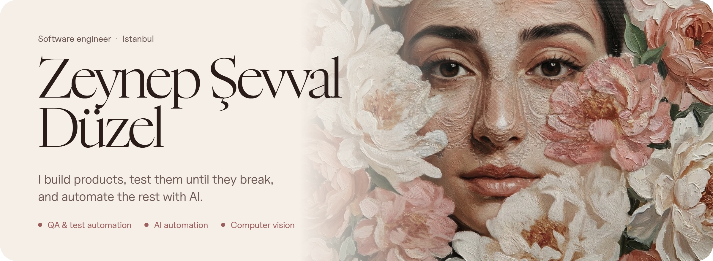
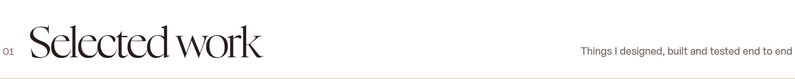
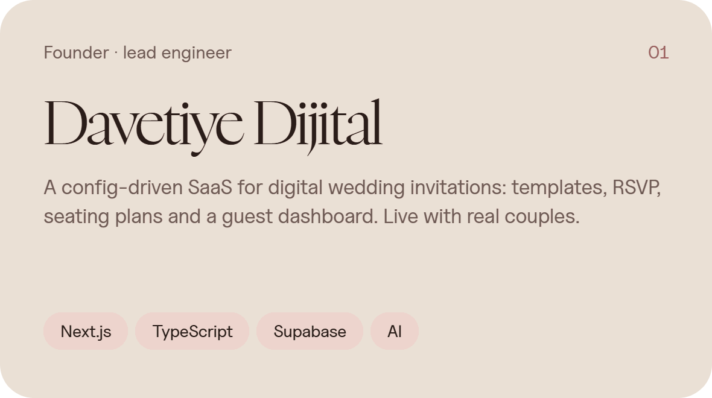
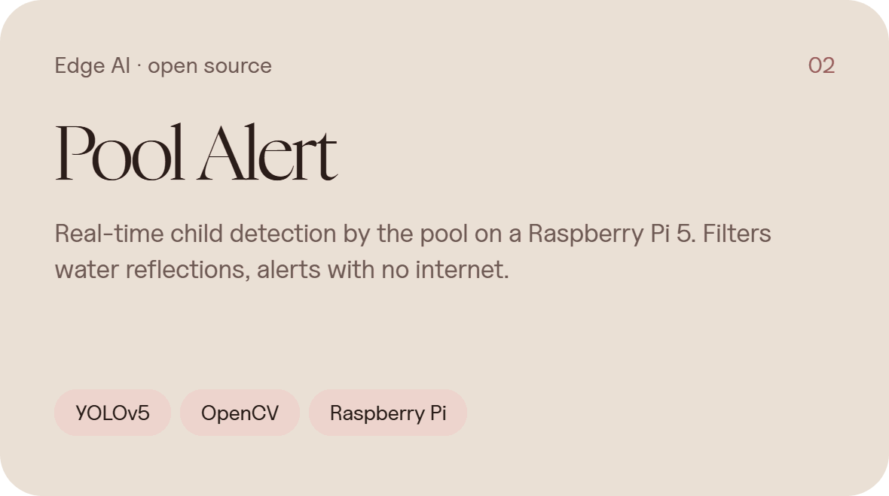
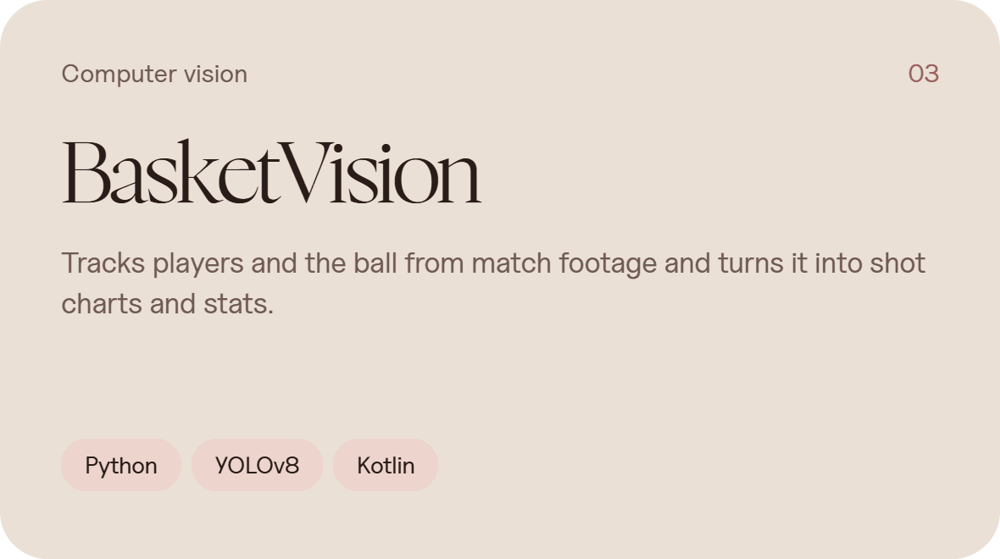
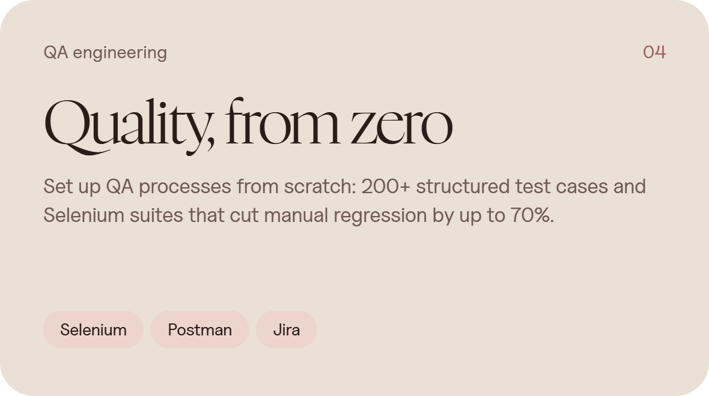
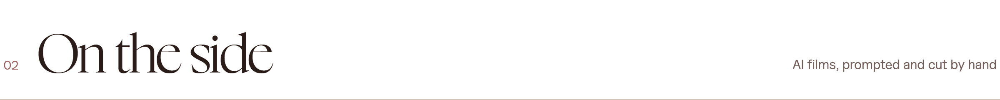
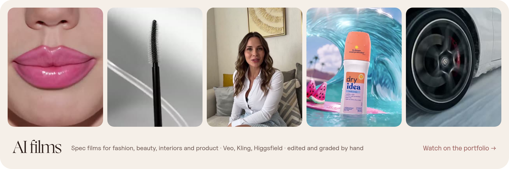
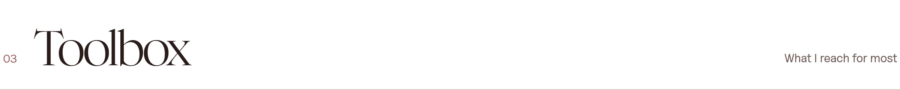

<a href="https://zeynepsduzel.artydigital.com.tr"><picture><source media="(prefers-color-scheme: dark)" srcset="assets/banner-dark.png"></picture></a>

  <a href="https://zeynepsduzel.artydigital.com.tr">Portfolio</a> &nbsp;·&nbsp;
  <a href="https://medium.com/@zeynepsduzel">Medium</a> &nbsp;·&nbsp;
  <a href="https://www.linkedin.com/in/zeynepduzel/">LinkedIn</a> &nbsp;·&nbsp;
  <a href="mailto:zeynepsduzel@gmail.com">Email</a>

 

I'm a computer engineer working across **software engineering, QA and AI automation**. I founded and built **Davetiye Dijital**, a config-driven wedding-invitation SaaS, and I ship AI-powered products and client tooling at **[Arty Digital](https://artydigital.com.tr)**.

My habit from QA follows me everywhere: assume it breaks, then go find how. I like owning a system end to end, from architecture and automation to the edge cases nobody else thought to test. Before all that I worked on **computer vision** (YOLO, OpenCV, Raspberry Pi) and **embedded systems** (MSP430, C).

 

<picture><source media="(prefers-color-scheme: dark)" srcset="assets/h-work-dark.png"></picture>

<a href="https://davetiyedijital.com/"><picture><source media="(prefers-color-scheme: dark)" srcset="assets/p-davetiye-dark.png"></picture></a>
<a href="https://github.com/zeysdzl/pool_guard"><picture><source media="(prefers-color-scheme: dark)" srcset="assets/p-pool-dark.png"></picture></a>

<picture><source media="(prefers-color-scheme: dark)" srcset="assets/p-basket-dark.png"></picture>
<picture><source media="(prefers-color-scheme: dark)" srcset="assets/p-qa-dark.png"></picture>

Also on GitHub: <a href="https://github.com/zeysdzl/medium_yolo">YOLOv8 detection pipeline</a> · <a href="https://github.com/zeysdzl/chess-timer">Arduino chess timer</a> · <a href="https://github.com/zeysdzl/cinema-ticket-reservation">Cinema reservation system</a> · <a href="https://github.com/zeysdzl/Gardropsapp">Jetpack Compose shop UI</a> · <a href="https://github.com/zeysdzl/2026-digital-planner-vba">VBA planner engine</a>

  

<picture><source media="(prefers-color-scheme: dark)" srcset="assets/h-side-dark.png"></picture>

<a href="https://zeynepsduzel.artydigital.com.tr/portfolio/ai-films"><picture><source media="(prefers-color-scheme: dark)" srcset="assets/films-dark.png"></picture></a>

  

<picture><source media="(prefers-color-scheme: dark)" srcset="assets/h-stack-dark.png"></picture>

**Build** &nbsp;       

**Test** &nbsp;    

**AI** &nbsp;      

**Ship** &nbsp;     

**Film** &nbsp;     

 

Now: building at Arty Digital · leading Davetiye Dijital · second degree in Management Information Systems at Anadolu University
