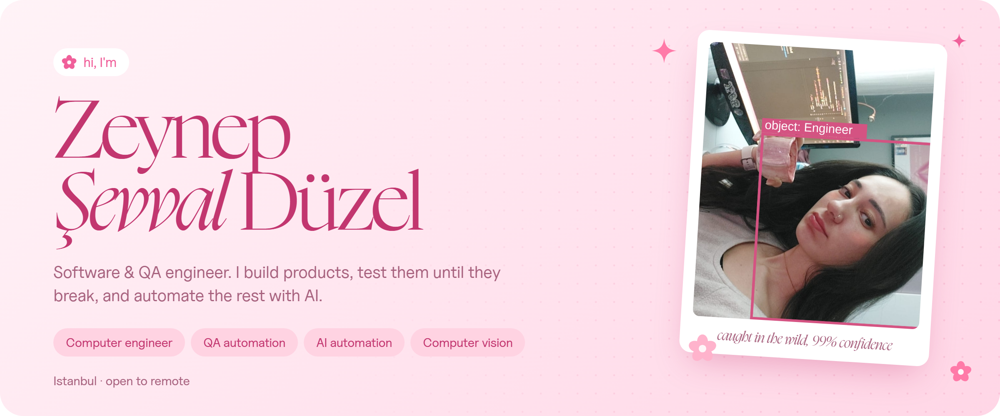

<a href="https://zeynepsduzel.artydigital.com.tr">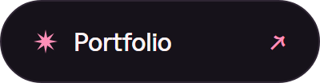</a>
<a href="https://www.linkedin.com/in/zeynepduzel/">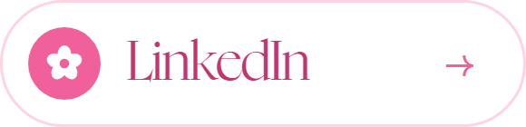</a>
<a href="https://medium.com/@zeynepsduzel">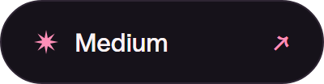</a>
<a href="mailto:zeynepsduzel@gmail.com">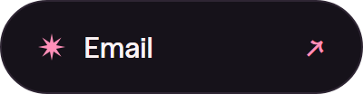</a>

 

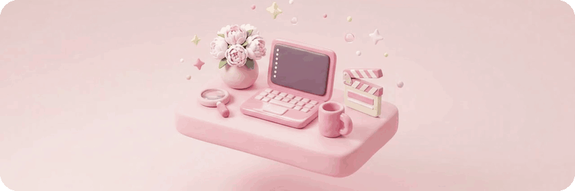

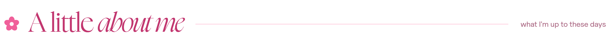

I'm a **computer engineer** working across software engineering, QA and AI automation. I like owning a system end to end: the architecture, the automation, and the edge cases nobody else thought to test. Good engineering and good QA come from the same instinct: assume it breaks, then go find how. Before all this I worked on computer vision (YOLO, OpenCV, Raspberry Pi) and embedded systems (MSP430, C).

 

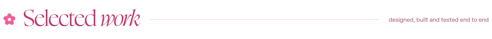

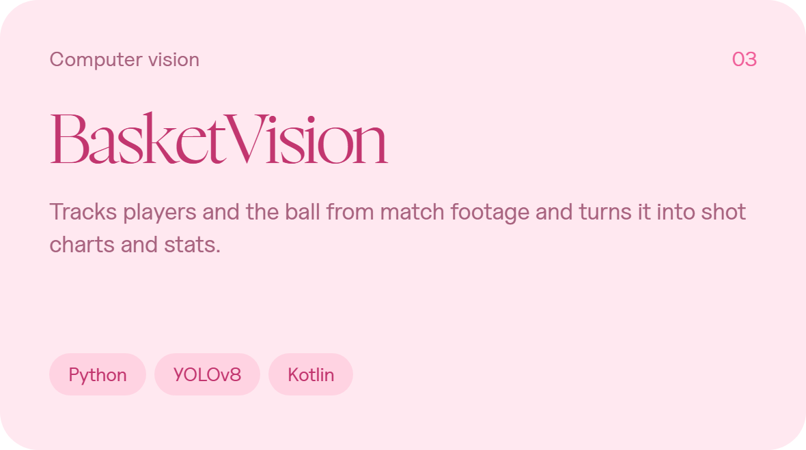

also here ✿ <a href="https://github.com/zeysdzl/medium_yolo">YOLOv8 pipeline</a> · <a href="https://github.com/zeysdzl/chess-timer">Arduino chess timer</a> · <a href="https://github.com/zeysdzl/cinema-ticket-reservation">Cinema reservations</a> · <a href="https://github.com/zeysdzl/Gardropsapp">Compose shop UI</a> · <a href="https://github.com/zeysdzl/2026-digital-planner-vba">VBA planner</a>

 

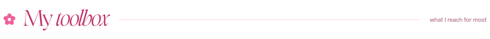

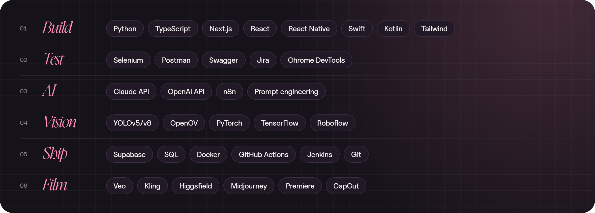

  

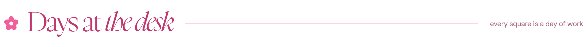

  

   
  thanks for stopping by ♡

